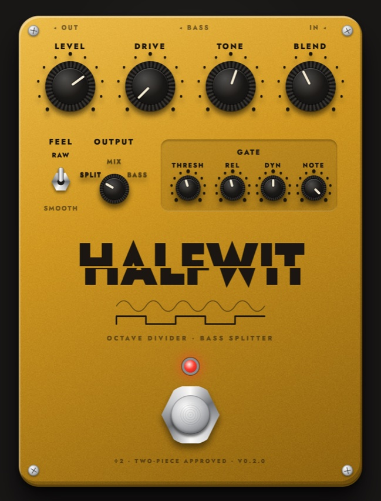

# Halfwit



An octave-divider bass splitter for guitar, as a VST3 and CLAP plugin
for macOS and Windows. It's for two-piece bands with no bass player: it
builds a bass part from the guitar signal, one octave down, and sends it
out a separate Bass output so it can go to its own track, with its own
amp, while the guitar carries on untouched.

It's a digital take on the old flip-flop divider pedals, not a pitch
shifter. Single notes and riffs track tightly; chords turn to mush, and
that's part of the sound.

## How it works

1. A band-limited copy of the input feeds a zero-crossing detector with
   hysteresis, so harmonics and string noise don't trigger it. The
   band follows the note's pitch, so the low strings' strong second
   harmonic can't double the count and jump the bass up an octave.
2. Every rising crossing flips a square wave, which halves the
   frequency. In Smooth feel, the square drives a rounded wave instead.
3. A gate silences the layer between notes, and Dynamics makes it
   follow the playing level. Both read the detector's band-limited
   copy, so pick scrapes and fret noise barely open them. Then drive, a
   two-pole low-pass (Tone) and a DC blocker shape the layer.
4. The Output selector decides where it goes: by default the guitar
   leaves the main output and the bass leaves the Bass aux output.

The square's edges are anti-aliased with PolyBLEP. That correction
needs one sample of lookahead, so Halfwit reports one sample of
latency, which hosts compensate for.

## Controls

| Control | Range | What it does |
|---|---|---|
| Level | 0–100% | Bass layer level going into the drive |
| Blend | 0–100% | Bass layer output level |
| Tone | 40 Hz–2 kHz | Low-pass cutoff on the bass layer |
| Drive | 0–200% | Saturates the bass layer and hides divider glitches |
| Feel | Raw / Smooth | Raw is the hard square; Smooth is rounder, closer to a sine |
| Output | Split / Mix / Bass | Split: guitar on the main output, bass on the Bass output. Mix: both on the main output, like an octave pedal. Bass: only the bass, on the main output |
| Gate: Thresh | −80–0 dB | Input level, below 700 Hz, under which the bass layer shuts off |
| Gate: Rel | 1–500 ms | How long the gate stays open after the input drops |
| Gate: Dyn | 0–100% | How far the bass layer follows your picking: 0% is a constant level, 100% tracks it fully up to −18 dBFS. Higher settings keep stray noises quiet |
| Gate: Note | E2–E5, Off | The highest note the bass plays under. Higher notes shut it off, so it can follow riffs on the low strings and drop out for leads up the neck. Off by default |
| Footswitch | On / Off | Turns the bass layer on and off; the guitar still passes |

Drag a knob up or down (hold Shift for fine moves), scroll, or use the
arrow keys. Double-click a knob to reset it. Click the Output selector
to step through its positions.

## Routing the bass to its own track

The Bass output is a second stereo bus. In REAPER:

1. Put Halfwit first on the guitar track, and set the track to 4
   channels (the routing button → Track channels). REAPER sends the Bass
   output to channels 3–4, and plugins after Halfwit, like an amp sim,
   only touch 1–2.
2. Make a Bass track, and add a send to it from the guitar track:
   audio from channels 3–4 into 1–2, post-FX.
3. Put a bass amp on the Bass track.

In hosts without multi-output support, use Mix, or Bass on a duplicate
of the guitar track.

## Tips

- Put Halfwit before your amp sim, like a pedal.
- The detector tracks best on the neck pickup with clean, single notes.
  Palm mutes and power chords work; full chords won't.
- Set Gate: Thresh just above your noise floor, especially with
  single-coil pickups, or hum will keep the divider chattering.
- Gate: Note goes by pitch, not by string. Around G3–A3, the bass follows
  the low strings in open position and drops out on the high strings,
  but a low-string note high on the neck counts as high too. The bass
  comes in about one cycle into a low note, and stops within about 20 ms
  of a jump to a high one.
- If pick scrapes or fret noise still come through, turn up Gate: Dyn
  so they come out quieter, then make up the level with Level or Blend.

## Installing

Download the zip from
[Releases](https://github.com/starzonmyarmz/halfwit/releases) and follow
`INSTALL.txt` inside it.

## Building

```sh
cargo xtask bundle halfwit --release       # target/bundled/Halfwit.{vst3,clap}
scripts/install.sh                         # bundle, sign ad hoc and install on macOS
scripts/clap-validator.sh target/bundled/Halfwit.clap
```

## Tests

`cargo test` runs the engine offline: a guitar DI rendered against
stored golden renders, plus synthetic tests for tracking, the gate,
routing and sample rates. After an intended change to the sound, rerun
with `HALFWIT_BLESS=1` to rewrite the renders, and listen to them before
committing.

## Working on the UI

The editor is a webview showing `ui/index.html`, which is compiled into
the plugin. Without the plugin, the page runs against a mock, so you can
work on it in a browser:

```sh
cd ui && python3 -m http.server 8765    # open http://127.0.0.1:8765
```

Add `?version=1.2.0` to show a version other than `0.0.0`. To load
the page live in the plugin, set `HALFWIT_UI_URL` to that URL
before starting the host.

## CI and releases

- `check.yml` runs on pushes to main and on PRs: the tests and
  clap-validator on macOS, and clap-validator on the Windows build.
- `release.yml` runs on `vX.Y.Z` tags. The tag must match `version` in
  the root `Cargo.toml`. It builds a universal macOS bundle and a
  Windows bundle, validates both, and publishes `Halfwit-X.Y.Z.zip`
  with `INSTALL.txt`.
- `screenshot.yml` runs on pushes to main that touch `ui/`, the version
  or `plugin/src/lib.rs`. It retakes `docs/halfwit.jpg` with
  `scripts/screenshot.sh`, sets its width in the README, and commits both
  if the image changed.

## Built with

- [nice-plug](https://codeberg.org/RustAudio/nice-plug), pinned to
  [a fork](https://github.com/starzonmyarmz/nice-plug/tree/patina) that
  adds `ActivateContext::gui_context()`.
- [Jost](https://github.com/indestructible-type/Jost) by Owen Earl,
  under the SIL Open Font License (`ui/fonts/OFL.txt`).
- Started from
  [plugin-template](https://github.com/starzonmyarmz/plugin-template),
  with the editor from
  [Patina](https://github.com/starzonmyarmz/patina).
